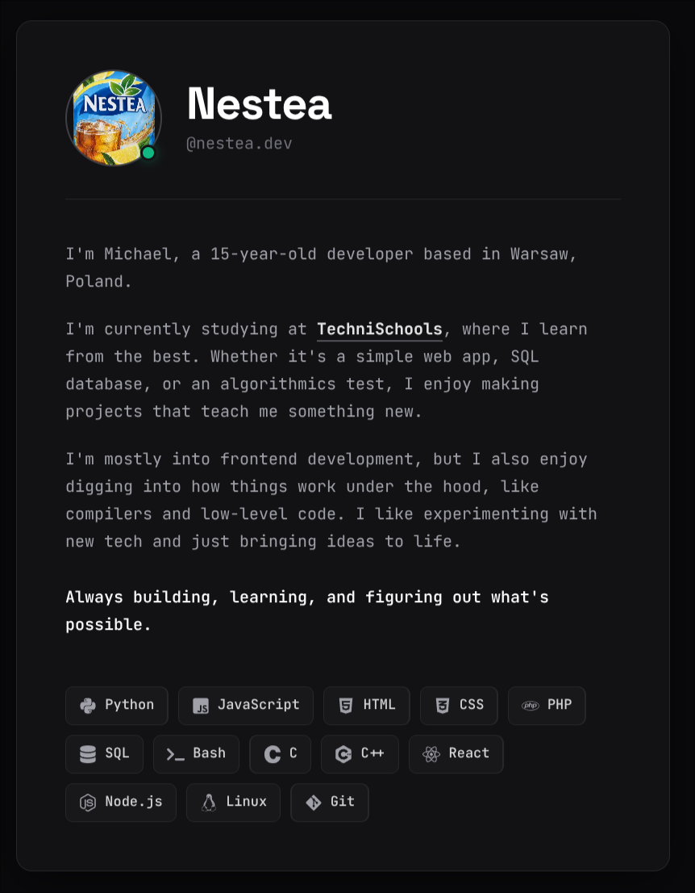
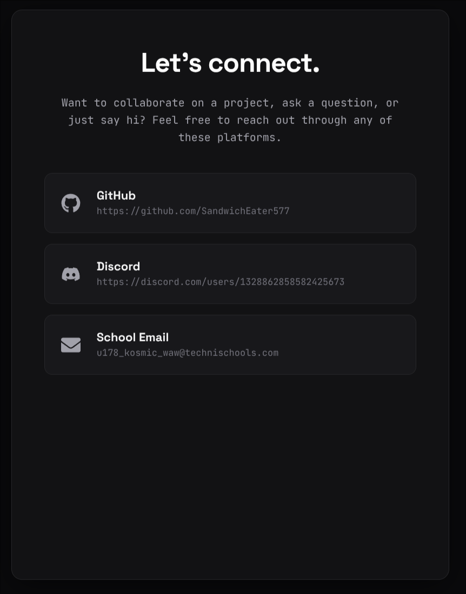

<div align="center">

# NesTea | Dev

**My personal portfolio website.**

[](https://my-portflio-blue.vercel.app/)
[](https://vitejs.dev/)

[**Visit the live site →**](https://my-portflio-blue.vercel.app/)

</div>

---

## Showcase

### About Me



### Contact



---

## Run it locally

You need [Node.js](https://nodejs.org/) installed.

```bash
# 1. clone the repo
git clone https://github.com/SandwichEater577/My-Portfolio.git

# 2. enter the folder
cd My-Portfolio

# 3. install dependencies
npm install

# 4. start the dev server
npm run dev
```

Vite will print a local link, usually `http://localhost:5173/`:

```bash
> portfolio@0.0.0 dev
> vite

  VITE v8.3.5  ready in 410 ms

  ➜  Local:   http://localhost:5173/
  ➜  Network: use --host to expose
  ➜  press h + enter to show help
```

Open it in your browser and you're done.

## Scripts

| Command           | What it does                    |
| ----------------- | ------------------------------- |
| `npm run dev`     | Start the dev server            |
| `npm run build`   | Build for production to `dist/` |
| `npm run preview` | Preview the production build    |

## Project structure

```
Portfolio
├── Images/        # README screenshots
├── public/        # static assets
├── src/           # source code
├── index.html     # entry point
└── vite.config.js
```

## Deployment

Hosted on [Vercel](https://vercel.com/). Every push to `main` redeploys automatically.

---

<div align="center">

Made by [NesTea](https://github.com/SandwichEater577)

</div>
