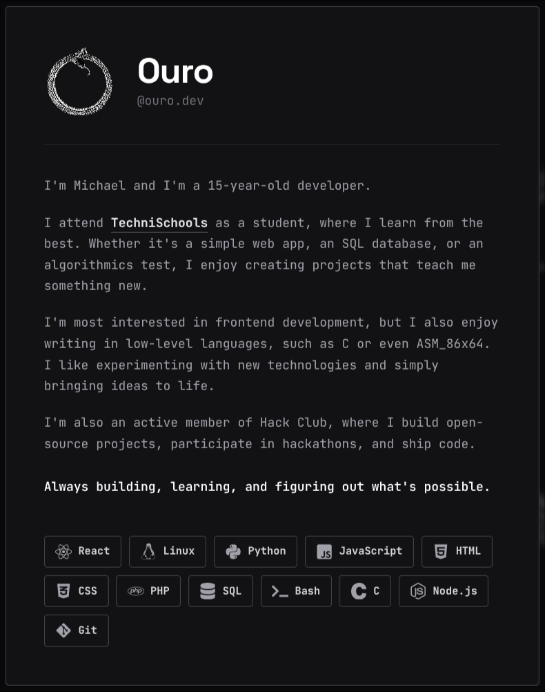
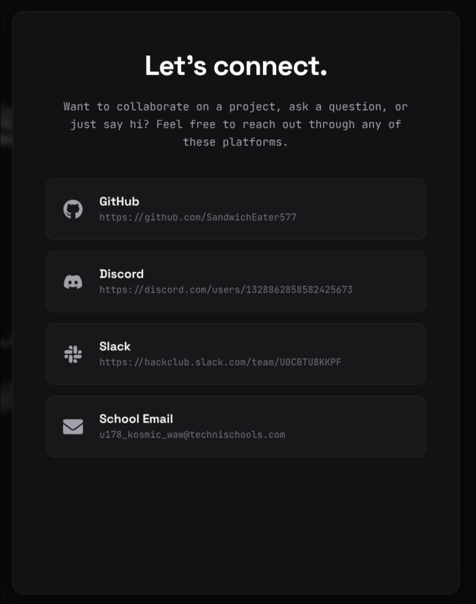
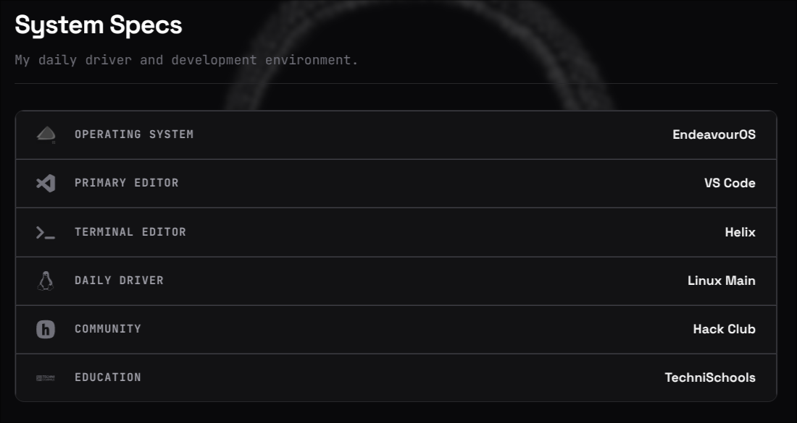

<div align="center">

# Ouro | Dev

My personal portfolio. Built with React + Vite, just so I have one place for my projects and socials.

[](https://my-portflio-blue.vercel.app/)

[**Visit the live site →**](https://my-portflio-blue.vercel.app/)

</div>

---

## About the project

This is my personal portfolio. I built it from scratch using React and Vite to have a central place for my projects and social links. I didn't want to use a pre-made template, mostly because I wanted to practice building a UI from scratch and having full control over the codebase.

The site is a single-page application with a dark theme. It includes a custom glow animation that follows your mouse, a spinning avatar, and a scrolling marquee for the "Trusted by" section. I also added a System Specs section so people can see what tools and OS I use daily.

For styling, I used pure CSS to practice layout and animations without relying on frameworks like Tailwind. There's a custom animation component that handles the glowing effects and hover states across different sections. The whole site is fully responsive and works on mobile devices.

I built a simple language toggle for English and Polish. Instead of hardcoding text inside the components, everything (translations, projects, setup specs, skills) is stored in a single `data.js` file. This makes it really easy to update content or add new projects without digging through the JSX. The project is hosted on Vercel, and every push to the main branch triggers an automatic deployment.

---

## Showcase

### About Me



### Contact



### System Specs



---

## Stack

<p align="left">
  
  
  
  
  
</p>

## Run it locally

You need Node.js installed.

```bash
# 1. clone the repo
git clone https://github.com/SandwichEater577/My-Portfolio.git

# 2. cd into the folder
cd My-Portfolio

# 3. install dependencies
npm install

# 4. start the dev server
npm run dev
Vite will start on http://localhost:5173/.
```

## Scripts

| Command           | What it does                     |
| ----------------- | -------------------------------- |
| `npm run dev`     | Starts the dev server            |
| `npm run build`   | Builds for production to `dist/` |
| `npm run preview` | Previews the production build    |

## Project structure

```text
Portfolio
├── Images/        # README screenshots
├── public/        # static assets
├── src/           # source code
├── index.html     # entry point
└── vite.config.js
```

## Deployment

Hosted on Vercel. Every push to main auto-deploys.

## License

MIT. See the LICENSE file for details.

<div align="center">
Made by Ouro

</div>

# AI

i used AI for learning whats robots.txt, and sitemap.xml, after descovering .xml, i asked does it need to be that ugly, then i discovered .xsl

thats all from AI
